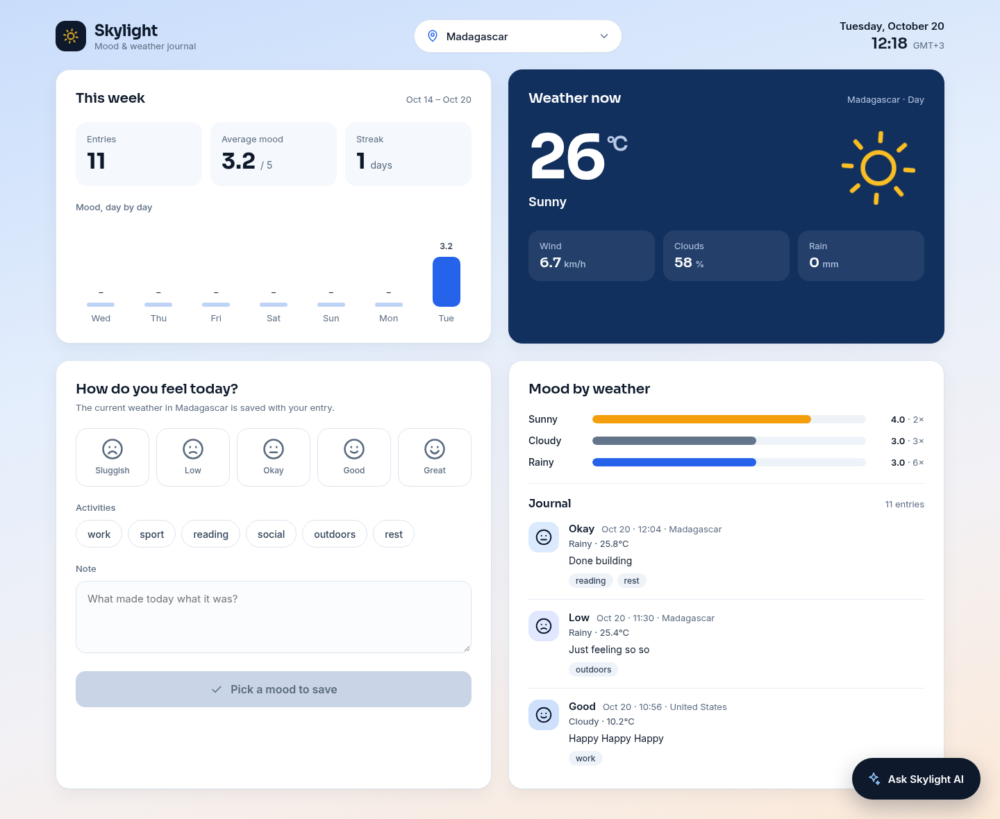

# Skylight ☀️

**A daily mood journal that pairs how you feel with the live weather.**

Log your mood, notes and activities. Skylight automatically saves the weather at that exact moment with each entry, so over time you can see how sunshine, clouds and rain affect you. A built-in AI assistant (Google Gemini) writes weekly reflections and suggests what to do today based on the weather.

🔗 **Live demo:** [skylight-zeta.vercel.app](https://skylight-zeta.vercel.app)



## Features

- **Mood check-in**: pick a mood from Sluggish to Great, tag activities (work, sport, reading…) and write a note.
- **Automatic weather tagging**: each entry stores the live temperature, wind, clouds and rain for the selected country.
- **Weekly dashboard**: entry count, average mood, logging streak and a day-by-day mood chart.
- **Mood by weather**: see your average mood on sunny, cloudy and rainy days.
- **AI assistant**: a weekly reflection on your journal, plus recommendations for today based on the weather and what lifts your mood.
- **Any country**: a searchable country picker, with the local date and live clock in that country's time zone.
- **Day/night theme**: the app switches to dark mode when it's night in the selected country, with a sky-gradient background.

## Tech stack

| Part | Technology |
|---|---|
| Frontend | [Preact](https://preactjs.com/) + TypeScript + [Vite](https://vite.dev/) |
| Backend | Rust + [axum](https://github.com/tokio-rs/axum) |
| Database | [Supabase](https://supabase.com/) (Postgres) |
| Weather | [Open-Meteo](https://open-meteo.com/) (free, no key needed) |
| AI | [Google Gemini](https://ai.google.dev/) |
| Hosting | Vercel (frontend) · Render (backend) |

## Project structure

```
skylight/
├── skylight-backend/          Rust API
│   ├── src/
│   │   ├── main.rs            server + routes
│   │   ├── routes.rs          countries, weather, entries
│   │   ├── ai.rs              weekly reflection + recommendations
│   │   ├── gemini.rs          Gemini API client
│   │   ├── entries.rs         journal storage (Supabase)
│   │   ├── weather.rs         Open-Meteo client
│   │   ├── countries.rs       country list
│   │   └── data/countries_data.json
│   └── supabase/schema.sql    database table
└── skylight-frontend/         Preact app
    └── src/
        ├── app.tsx            page layout + data loading
        ├── api.ts             calls to the backend
        └── components/        Header, Dashboard, WeatherCard, EntryForm, Insights, EntryList, AiPanel…
```

## API

| Method | Route | Description |
|---|---|---|
| `GET` | `/api/countries` | List of countries with coordinates |
| `GET` | `/api/countries/{code}/weather` | Live weather for a country (e.g. `MG`) |
| `GET` | `/api/entries` | All journal entries, newest first |
| `POST` | `/api/entries` | Save an entry (the backend adds the live weather) |
| `GET` | `/api/ai/weekly-reflection?since=YYYY-MM-DD` | AI summary of the week |
| `GET` | `/api/ai/recommendations/{code}` | AI suggestions for today |

## Run it locally

You need [Rust](https://rustup.rs/), [Node.js](https://nodejs.org/), a [Supabase](https://supabase.com/) project and a [Gemini API key](https://aistudio.google.com/apikey).

**1. Database:** in Supabase, open the **SQL Editor** and run [`skylight-backend/supabase/schema.sql`](skylight-backend/supabase/schema.sql).

**2. Backend**

```bash
cd skylight-backend
cp .env.example .env    # then fill in GEMINI_API_KEY, SUPABASE_URL and SECRET_KEY
cargo run               # http://localhost:3000
```

**3. Frontend**

```bash
cd skylight-frontend
npm install
npm run dev             # http://localhost:5173
```

With `VITE_API_URL` left empty, the frontend uses the local backend through Vite's proxy. Set it in `skylight-frontend/.env` to use a deployed backend instead.

## Deployment

- **Backend (Render):** root directory `skylight-backend`, build `cargo build --release`, start `./target/release/skylight-backend`. Add `GEMINI_API_KEY`, `SUPABASE_URL` and `SECRET_KEY` as environment variables.
- **Frontend (Vercel):** root directory `skylight-frontend`. Add `VITE_API_URL` set to the backend's URL.

## License

[YOUR LICENSE]
